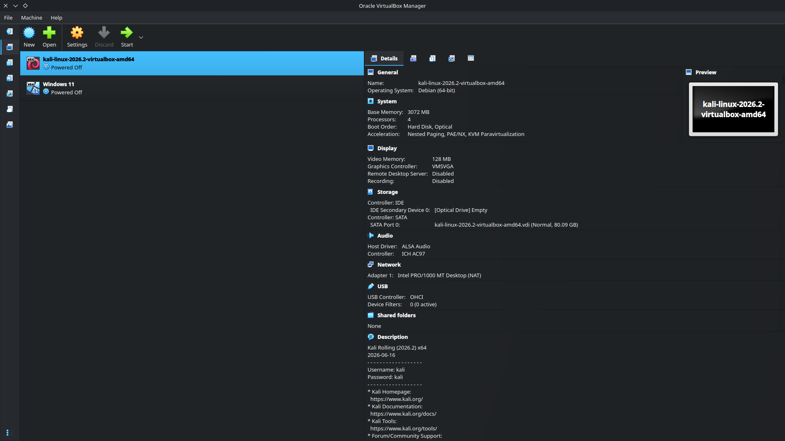
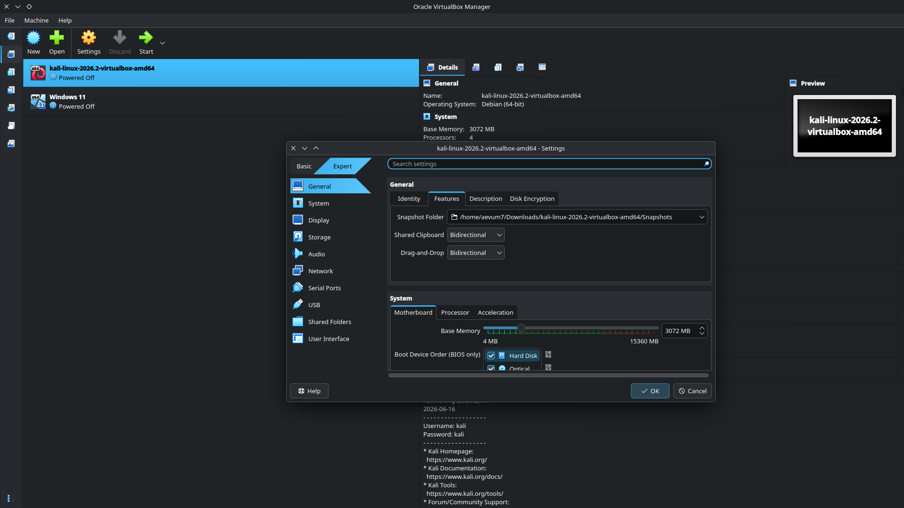

# 🛡️ Cybersecurity & Ethical Hacking Lab Setup (WK1-PM1)

**Author:** Md. Shihab Shahriar Rashu  
**Batch:** B084  
**Program:** Cybersecurity Internship — Networkwalks Academy  
**Module:** Week 1 - Project Module 1 (WK1-PM1)  

---

## 📌 Project Overview
This repository documents the step-by-step setup and configuration of an isolated virtual laboratory environment for cybersecurity testing and ethical hacking practice. The lab uses **Oracle VirtualBox** and **Kali Linux (2026.2)** connected via a custom **NAT Network** (`10.0.0.0/24`) to ensure secure, isolated communication between virtual machines alongside full internet access.

> **Disclaimer:** All configurations and tests documented in this repository were performed strictly on my own local system and virtual machines for educational and authorized research purposes.

---

## 🌐 Lab Network Architecture
* **Hypervisor:** Oracle VirtualBox
* **Network Mode:** NAT Network (`NatNetwork`)
* **Network Subnet:** `10.0.0.0/24` (DHCP Enabled)
* **Default Gateway:** `10.0.0.1`
* **Kali Linux Static IP:** `10.0.0.2/24`
* **DNS Server:** `8.8.8.8`

---

## ⚙️ Step-by-Step Implementation & Screenshots

### Step 1: VirtualBox Overview & Kali Linux Import
Imported the pre-built **Kali Linux 2026.2 (64-bit)** virtual machine into Oracle VirtualBox Manager.



---

### Step 2: Configuring the NAT Network (`NatNetwork`)
Opened **VirtualBox Network Manager** (`Ctrl+H`) and created a custom NAT Network named `NatNetwork` with the IPv4 Prefix `10.0.0.0/24` and enabled DHCP.


---

### Step 3: Enabling Bidirectional Clipboard & Drag-and-Drop
Navigated to **General -> Features** in the Kali Linux VM settings and enabled **Bidirectional** mode for both Shared Clipboard and Drag-and-Drop to allow smooth data transfer between the host OS and guest VM.



---

### Step 4: System Base Memory Allocation
Allocated sufficient system memory (**2048 MB+ RAM**) under **System -> Motherboard** for stable performance.


---

### Step 5: Configuring Network Adapter 1
Attached **Adapter 1** to `NAT Network` (`NatNetwork`), selected the `Intel PRO/1000 MT Desktop (82540EM)` adapter type, and set **Promiscuous Mode** to `Allow All` for network packet analysis and security testing.


---

### Step 6: Configuring Auto-Mount Shared Folders
Configured a shared `Downloads` folder between the Host OS and Kali Linux VM with **Full Access** and **Auto-mount** enabled.


---

### Step 7: Assigning Manual Static IP in Kali Linux
Inside Kali Linux, opened **Advanced Network Configuration (`Edit Connections`)** for `Wired connection 1` and configured manual IPv4 settings:
* **Address:** `10.0.0.2`
* **Netmask:** `24`
* **Gateway:** `10.0.0.1`
* **DNS Server:** `8.8.8.8`


---

### Step 8: Resolving DAD Timeout & Activating Network Connection
To prevent the Duplicate Address Detection (DAD) issue on VirtualBox v7+ and Kali Linux 2026.2, executed the following `nmcli` commands to disable the DAD timeout and restart the interface:

```bash
sudo nmcli connection modify "Wired connection 1" ipv4.dad-timeout 0
sudo nmcli connection down "Wired connection 1"
sudo nmcli connection up "Wired connection 1"
